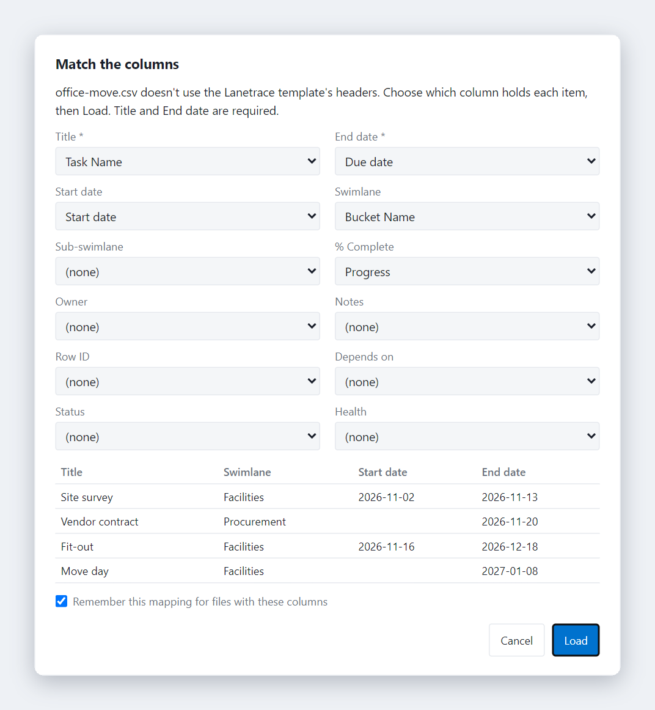
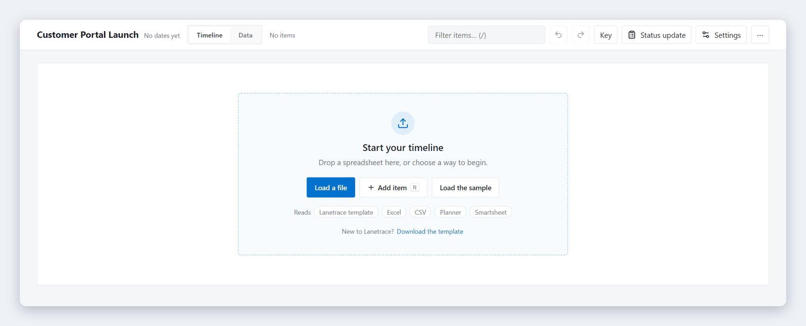
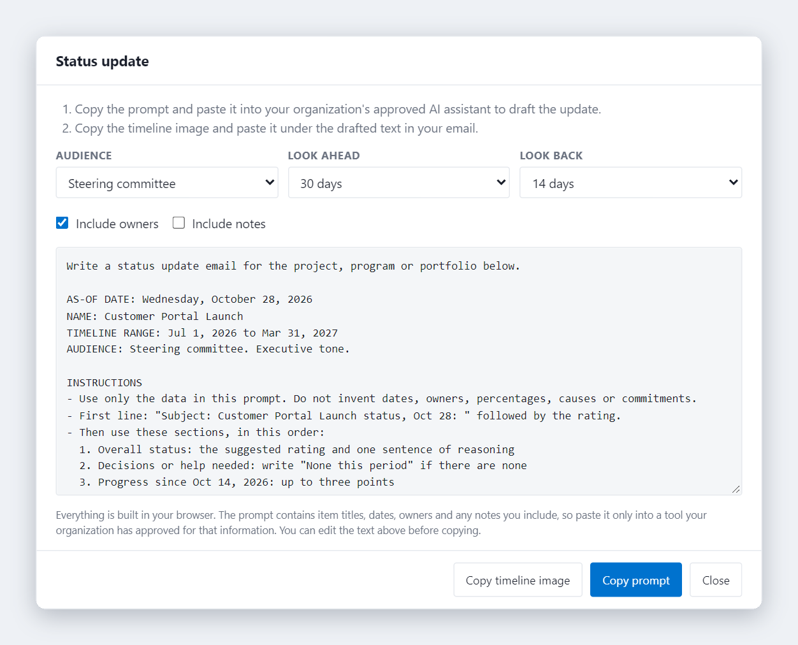

# Lanetrace

**Timelines, without the platform.**

One HTML file. Excel in, steering-committee visuals out. No server, no login, no telemetry.

Lanetrace turns a spreadsheet into a swimlane timeline for a project, program or portfolio. It runs in any modern browser, and your data never leaves it.

**Version 4.16.0.** [Download lanetrace.html](public/lanetrace.html), open it, and the sample plan loads. See the [changelog](CHANGELOG.md) for what's new.

## What It Does

Drop in a spreadsheet and get a roadmap you can put in front of executives:

- **Swimlanes** for organizing work by team, phase or workstream, with sub-swimlanes
- **Five item types**: phases, tasks, milestones, events and decisions
- **Imports**: the Lanetrace Excel template, any Excel or CSV file, and exports from Microsoft Planner and Smartsheet
- **Two ways to edit**: one item form, or inline in the Data view grid
- **Exports**: SVG, PNG, PDF, PowerPoint, clipboard, Excel and CSV
- **Status updates**: builds an AI prompt for a status email from your dates and progress
- **Themes**: nine color packs, each in light, dark and auto modes
- **Density options**: ultra-compact to spacious

## Features at a Glance

**Dark mode with dependency arrows.** Turn on arrows to see which items wait on others. Hover an item to highlight its chain.

**The Data view, by swimlane.** Edit inline like a spreadsheet. By swimlane groups rows under each swimlane and sub-swimlane, and you can drag a row to another group.

**Match the columns.** A file whose headers don't match the template opens this dialog. Pick the column for each field, check the preview, and Lanetrace remembers the choice for files with the same columns. Planner and Smartsheet exports map on their own.

**A clear place to start.** With no items, the chart becomes a drop target with three ways in. When filters, hidden swimlanes or the Shown column hide everything, it says which and offers the fix.

## Why It Exists

Project, program and portfolio managers need timeline visuals for executive presentations. MS Project is overkill. PowerPoint shapes are tedious. Office Timeline costs money.

Lanetrace fills the gap: a free, portable tool that works from a single HTML file with no install required.

It takes cues from Office Timeline (now Lucen), Microsoft Project, Microsoft Planner and SharePoint Lists.

## Quick Start

1. Download `public/lanetrace.html`
2. Open it in any modern browser (Chrome, Edge, Firefox, Safari)
3. The built-in sample data demonstrates all features
4. To load your own data:
   - Click **Settings** > **Download template** to get the Excel template (a copy is also in [examples/](examples/))
   - Fill in your data. The template's Instructions sheet explains every column
   - Drag-drop the file onto the app (or click **Load file** in Settings). A CSV with the same headers works too
   - A Planner or Smartsheet export loads as it is. Any other spreadsheet opens Match the columns

## Features

### Timeline View
- SVG-based rendering
- Color-coded swimlanes with sub-swimlanes
- Collapsible swimlanes that show one summary bar with dates, item count and % complete
- Optional milestone strip above the timescale, for all milestones or pinned ones
- Today marker, or a custom "as of" date
- Dependency arrows, off by default: turn them on in Settings or the command palette. Hover over an item to highlight its chain; conflicts draw red and dashed
- Timescale rows that fit the date range (weeks for short projects, quarters for multi-year portfolios), grid and legend
- Bar labels pick white or dark text for contrast, in every theme
- Keyboard access: Tab to any item, Enter to edit

### Data View
- Inline cell editing with dropdowns and suggestions
- List, By swimlane or Milestones layout. By swimlane groups sub-swimlanes too, and a row dragged onto another group moves there. Milestones lists milestones, events and decisions by date
- New item opens the same item form the timeline uses
- Quick look column: open the item, preview notes, row menu
- Column reordering, custom columns and filters by swimlane, item type and visibility
- Data checks flag unreadable dates and missing fields
- Depends on column: list the Row IDs that must finish first. Lanetrace flags items that start before a predecessor finishes, unknown IDs and loops, and the status update names work waiting on late items

**The item form.** Title, description, type, owner and swimlane first, then schedule, dependencies, Markdown notes, a running Updates log and appearance options. Each update is saved with its date and time, newest first.

### Imports
- **Lanetrace template**: the Excel file from Settings, or one Lanetrace exported
- **Microsoft Planner**: Export as Excel. Buckets become swimlanes and the plan name becomes the title
- **Smartsheet**: Export to Excel. Indented rows become swimlanes and sub-swimlanes, and predecessors become dependencies
- **Any other Excel or CSV file**: Match the columns maps its headers onto Lanetrace's fields

### Item Types
| Type | Description |
|------|-------------|
| Phase | Bar with rounded ends, for project phases |
| Task | Bar with a pointed end, for work items |
| Milestone | Diamond marker, single point in time |
| Event | Triangle marker, external occurrence |
| Decision | Star marker, choice point |

### Status Updates

Pick an audience and a look-ahead window, then copy a prompt for your approved AI assistant and the timeline image for your email.

### Exports
- **SVG**: Vector format, editable in Illustrator/Figma
- **PNG and clipboard**: High-resolution image for slides and email
- **PDF**: Via browser print dialog
- **PowerPoint**: Embedded image on a 16:9 slide
- **Excel**: Every item with your edits, in the template layout, so it loads back in
- **CSV**: UTF-8, for other tools

### Customization
- Light/dark/auto theme
- Four density levels
- Swimlane colors and ordering
- Undo/redo

## Data Format

See [docs/data-format.md](docs/data-format.md) for the complete column reference.

**Required columns:**
- Row ID
- Swimlane
- Milestone/Task Title
- End date

**Optional columns** include Sub-swimlane, Start date (blank = milestone), % Complete, Owner, Depends on, Notes (Markdown), Item Type, Label Position, Milestone Shape, Bar Style, Milestone Row, Shown, Color Category, Title Color and Health.

## Privacy / Local-First

Lanetrace is entirely local:
- No server required
- No data sent anywhere
- No analytics or tracking
- Your data stays in your browser

The one network request: the first PowerPoint export downloads its library (PptxGenJS, version pinned and integrity-checked) from jsDelivr. Every other feature works offline.

Optional: Use the sync folder feature (Chromium only) to persist settings to a local folder.

## Browser Compatibility

| Browser | Status |
|---------|--------|
| Chrome | Full support |
| Edge | Full support |
| Firefox | localStorage only (no sync folder) |
| Safari | localStorage only (no sync folder) |

## SharePoint Preview

Clicking the file in a SharePoint document library opens it in SharePoint's preview, which runs it in a locked-down sandbox. There you can view and present the timeline, but:

- Edits and settings aren't saved. They reset when the file opens again
- Downloads, exports, printing and copying the image are blocked. Those buttons say so when you click them
- The sync folder doesn't work

For everything, click **⋯** > **Download** in SharePoint and open the downloaded file. Details are in [docs/sharepoint-notes.md](docs/sharepoint-notes.md).

## Not a Gantt Chart

Lanetrace does **not** currently support:
- Automatic rescheduling from dependencies (Lanetrace flags conflicts but never moves dates)
- Critical path analysis
- Resource leveling
- Drag-to-reschedule

If you need these features, use MS Project or similar tools.

## Roadmap

- [ ] Drag-to-reschedule items
- [ ] JSON data format support
- [ ] Clipboard paste from Excel

## Attribution

Created by Wesley Erickson | [pmpmaker.com](https://pmpmaker.com)

## License

MIT License - see [LICENSE](LICENSE)
