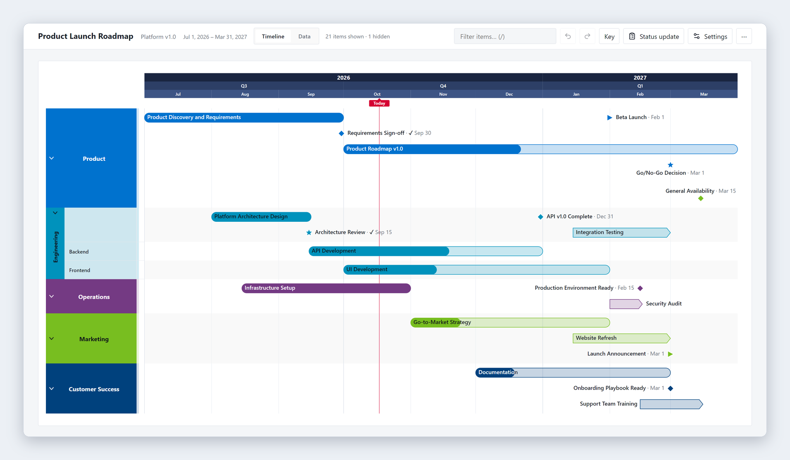
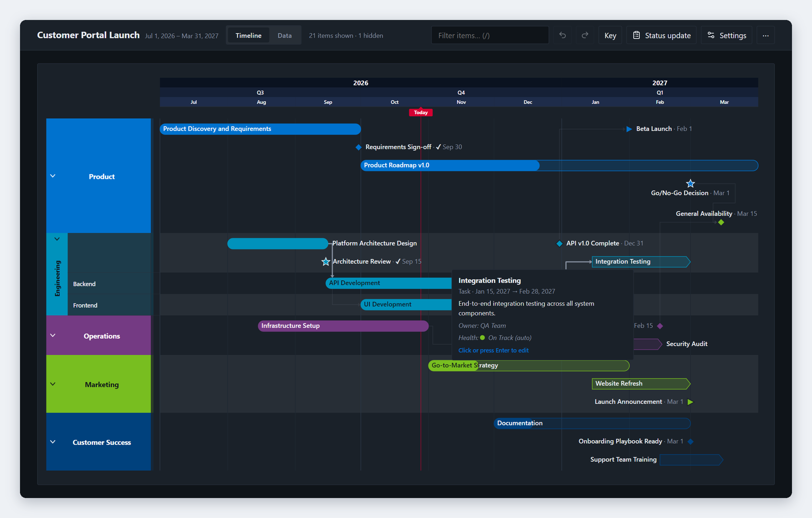
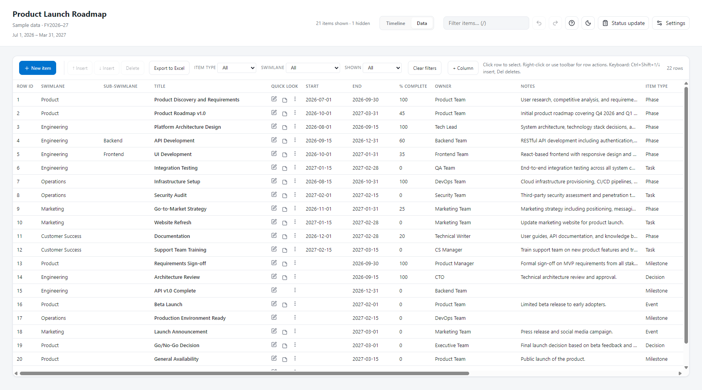
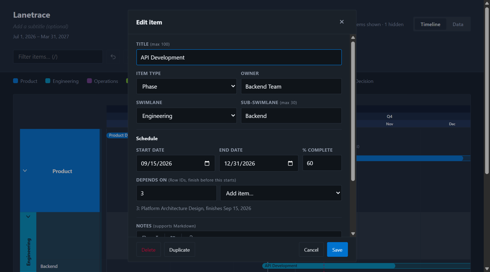

# Lanetrace

**Timelines, without the platform.**

Turn an Excel sheet into a swimlane timeline for any project, program or portfolio, in one HTML file that runs in any browser with no install, login or server.

## What It Does

Lanetrace turns Excel data into professional timeline visuals. Drop in a spreadsheet, and get a presentation-ready roadmap with:

- **Swimlanes** for organizing work by team, phase, or workstream
- **Multiple item types**: phases, tasks, milestones, events, decisions
- **Two ways to edit**: one item form, or inline in the Data view grid
- **Exports**: SVG, PNG, PDF, PowerPoint, clipboard, Excel and CSV
- **Status updates**: builds an AI prompt for a status email from your dates and progress
- **Themes**: nine color packs, each in light, dark and auto modes
- **Density options**: ultra-compact to spacious

## Screenshots

**The app in dark mode.** Swimlanes, sub-swimlanes, phases, tasks, milestones, events and decisions, with a Today marker.

**The Data view.** Edit inline like a spreadsheet, or open any row in the item form. Export the whole set to Excel.

**The item form.** Title, type, owner and swimlane first, then schedule, Markdown notes and appearance options.

## Why It Exists

Project, program and portfolio managers need timeline visuals for executive presentations. MS Project is overkill. PowerPoint shapes are tedious. Office Timeline costs money.

Lanetrace fills the gap: a free, portable tool that works from a single HTML file with no install required.

It takes cues from Office Timeline (now Lucen), Microsoft Project, Microsoft Planner and SharePoint Lists.

## Current Status

**Early prototype / pre-release**

Core functionality works, but the project is still being polished for public release. Expect rough edges.

## Quick Start

1. Download `public/lanetrace.html`
2. Open it in any modern browser (Chrome, Edge, Firefox, Safari)
3. The built-in sample data demonstrates all features
4. To load your own data:
   - Click **Settings** > **Download template** to get the Excel template (a copy is also in [examples/](examples/))
   - Fill in your data. The template's Instructions sheet explains every column
   - Drag-drop the file onto the app (or click **Load .xlsx**)

## Features

### Timeline View
- SVG-based rendering
- Color-coded swimlanes with sub-swimlanes
- Collapsible swimlanes that show one summary bar with dates, item count and % complete
- Optional milestone strip above the timescale, for all milestones or pinned ones
- Today marker, or a custom "as of" date
- Dependency arrows, off by default: turn them on in Settings or the command palette. Hover over an item to highlight its chain; conflicts draw red and dashed
- Timescale rows that fit the date range (weeks for short projects, quarters for multi-year portfolios), grid and legend
- Bar labels pick white or dark text for contrast, in every theme
- Keyboard access: Tab to any item, Enter to edit

### Data View
- Inline cell editing with dropdowns and suggestions
- New item opens the same item form the timeline uses
- Quick look column: open the item, preview notes, row menu
- Column reordering, custom columns and filters by swimlane, item type and visibility
- Data checks flag unreadable dates and missing fields
- Depends on column: list the Row IDs that must finish first. Lanetrace flags items that start before a predecessor finishes, unknown IDs and loops, and the status update names work waiting on late items

### Item Types
| Type | Description |
|------|-------------|
| Phase | Bar with rounded ends, for project phases |
| Task | Bar with a pointed end, for work items |
| Milestone | Diamond marker, single point in time |
| Event | Triangle marker, external occurrence |
| Decision | Star marker, choice point |

### Exports
- **SVG**: Vector format, editable in Illustrator/Figma
- **PNG and clipboard**: High-resolution image for slides and email
- **PDF**: Via browser print dialog
- **PowerPoint**: Embedded image on a 16:9 slide
- **Excel**: Every item with your edits, in the template layout, so it loads back in
- **CSV**: UTF-8, for other tools

### Customization
- Light/dark/auto theme
- Four density levels
- Swimlane colors and ordering
- Undo/redo

## Data Format

See [docs/data-format.md](docs/data-format.md) for the complete column reference.

**Required columns:**
- Row ID
- Swimlane
- Milestone/Task Title
- End date

**Optional columns** include Sub-swimlane, Start date (blank = milestone), % Complete, Owner, Depends on, Notes (Markdown), Item Type, Label Position, Milestone Shape, Bar Style, Milestone Row, Shown, Color Category and Title Color.

## Privacy / Local-First

Lanetrace is entirely local:
- No server required
- No data sent anywhere
- No analytics or tracking
- Your data stays in your browser

The one network request: the first PowerPoint export downloads its library (PptxGenJS, version pinned and integrity-checked) from jsDelivr. Every other feature works offline.

Optional: Use the sync folder feature (Chromium only) to persist settings to a local folder.

## Browser Compatibility

| Browser | Status |
|---------|--------|
| Chrome | Full support |
| Edge | Full support |
| Firefox | localStorage only (no sync folder) |
| Safari | localStorage only (no sync folder) |

## Not a Gantt Chart

Lanetrace does **not** currently support:
- Automatic rescheduling from dependencies (Lanetrace flags conflicts but never moves dates)
- Critical path analysis
- Resource leveling
- Drag-to-reschedule

If you need these features, use MS Project or similar tools.

## Roadmap

- [ ] Drag-to-reschedule items
- [ ] JSON data format support
- [ ] Clipboard paste from Excel

## Attribution

Created by Wesley Erickson | [pmpmaker.com](https://pmpmaker.com)

## License

MIT License - see [LICENSE](LICENSE)
